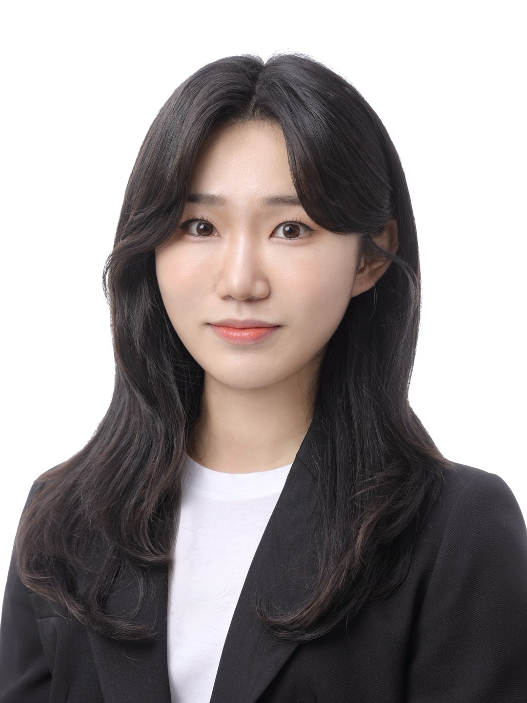

<section class="home-hero l-shell">
  

    <h1 class="hero-name">Yeonju Lee</h1>
    

      Ph.D. Student in Machine Learning, Georgia Institute of Technology 
      H. Milton Stewart School of Industrial &amp; Systems Engineering · Advisor: <a href="https://isye.gatech.edu/users/jing-li" target="_blank" rel="noopener">Prof. Jing Li</a>
    

    <h2 class="hero-title">Knowledge-Informed AI and ML for Complex Scientific and Physical Systems</h2>

    

      In hospitals, farms, and factories, AI must work with scarce labels and conditions that keep changing.
      My research makes AI reliable in these settings by building scientific and engineering knowledge, such as anatomy and soil&ndash;water&ndash;crop dynamics,
      into foundation models, generative models, and adaptive world models.
    

    

      <a href="/files/Yeonju_Lee_CV.pdf">CV</a>|
      <a href="https://scholar.google.com/citations?user=5iO-_XgAAAAJ&hl=en&oi=ao" target="_blank" rel="noopener">Google Scholar</a>|
      <a href="https://www.linkedin.com/in/ylee845" target="_blank" rel="noopener">LinkedIn</a>|
      <a href="mailto:ylee845@gatech.edu">ylee845@gatech.edu</a>
    

  

  

    
  

</section>

<section class="l-shell home-section">
  <h2 class="section-title">Research</h2>
  

    How can AI make trustworthy decisions about the physical world when data are limited and the environment shifts?
    I approach this question by integrating domain knowledge with modern AI across three connected capabilities.
  

  

    

      01
      <h3>Perception from scarce data</h3>
      
Teaching models what clinicians already know about anatomy, so they can segment and detect disease in 3D images from few labeled examples.

      
Knowledge-informed semi-supervised learning · generative models · foundation models

      
IEEE T-ASE 2025 · IISE THSE 2026 · Cytotherapy 2026

    

    

      02
      <h3>Reasoning over scientific signals</h3>
      
Using large language models to read soil-moisture sensor data the way an agronomist would, recognizing meaningful patterns and anomalies to support prediction.

      
LLM-based reasoning · spatiotemporal learning · anomaly detection

      
Comput. Electron. Agric. (under review) · ACS ES&amp;T Eng. 2026

    

    

      03
      <h3>Decisions under environment shifts</h3>
      
Giving controllers a learned simulator of how a system responds to actions, and letting it adapt to environments it has never seen.

      
World models · meta-learning · test-time adaptation · model predictive control

      
IISE Transactions (under review)

    

  

  
<a class="more-link" href="/research/">More about my research &rarr;</a>

</section>

<section class="l-shell home-section">
  <h2 class="section-title">Recent Work</h2>
  
Knowledge-Informed World Model Adaptation for Predictive Irrigation Control under Environmental Shifts

  
<strong>Y. Lee</strong>, X. Qiao, Y. Chen, J. Li · <em>IISE Transactions</em>, under review

  

    

      

        The same irrigation decision can help or hurt a crop depending on the soil and climate, so a controller learned on some farms often fails on new ones,
        where sensor data are too sparse to relearn the dynamics. This work combines what we can <em>read</em> about a new farm with the few things we can <em>measure</em> there.
      

      

        Across 60 unseen environments in simulation, the method improved crop-response prediction, lowered decision regret, and achieved the highest yield among compared methods.
        We also establish a regret bound that links prediction error to control quality.
      

    

    <ol class="recent-steps">
      <li><b>Learn shared dynamics.</b> A world model learns how irrigation drives soil moisture, canopy cover, and biomass.</li>
      <li><b>Use environmental knowledge.</b> An LLM encodes soil and climate descriptions, and a hypernetwork turns them into an environment-specific starting point.</li>
      <li><b>Adapt with sparse data.</b> A lightweight adapter is meta-learned and refined at test time from a few soil-moisture readings.</li>
      <li><b>Plan.</b> The adapted model drives model predictive control under a water budget.</li>
    </ol>
  

</section>

<section class="l-shell home-section">
  

    

      <h2 class="section-title">Selected Publications</h2>
      

        
Oral-Anatomical Knowledge-Informed Semi-Supervised Learning for 3D Dental CBCT Segmentation and Lesion Detection

        
<strong>Y. Lee</strong>, M.G. Kwak, R.Q. Chen, H. Yan, M. Mupparapu, F. Lure, F.C. Setzer, J. Li

        
<em>IEEE Transactions on Automation Science and Engineering</em>, 2025. IISE DAIS Best Paper Finalist.

      

      

        
Dentin-Normalized CBCT Radiomics within a Periapical Lesion Differential Diagnosis System for Differentiating Granulomas and Radicular Cysts

        
<strong>Y. Lee</strong>, R.Q. Chen, H. Yan, M. Mupparapu, F. Lure, J. Li, F.C. Setzer

        
<em>Journal of Endodontics</em>, in press, 2026.

      

      

        
BrainNormalizer: Anatomy-Informed Pseudo-Healthy Brain Reconstruction from Tumor MRI via Edge-Guided ControlNet

        
M.G. Kwak, <strong>Y. Lee</strong>, H. Wang, J. Li

        
<em>IISE Transactions on Healthcare Systems Engineering</em>, 2026.

      

      

        
Foundation Model Cascades Enable Zero-Shot Microscopy Image Analysis for Cell Therapy Manufacturing

        
R.Q. Chen, <strong>Y. Lee</strong>, B. Joffe, P.C. Costa, C. Filan, B. Wang, S. Balakirsky, F. Robles, K. Roy, J. Li

        
<em>Cytotherapy</em>, 2026.

      

      
<a class="more-link" href="/publications/">All publications &rarr;</a>

    

    

      <h2 class="section-title">News</h2>
      <ul class="news">
        <li>2026Paper on knowledge-informed world models for irrigation control submitted to <em>IISE Transactions</em>.</li>
        <li>2026<em>BrainNormalizer</em> selected for the journal&rsquo;s Monthly Spotlight Series and featured in <em>ISE Magazine</em>.</li>
        <li>2025George Fellowship and Stewart Fellowship, Georgia Tech ISyE.</li>
        <li>2025Invited talk, INFORMS Annual Meeting, Atlanta.</li>
        <li>2024Finalist, Best Track Paper Award, IISE DAIS.</li>
      </ul>
    

  

</section>
